# Manual Audit Findings & Defect Log

Fill in this document during your manual walkthrough. Once you record any findings, save the file and let me know in the chat — I will investigate the server logs, reproduce each finding with an automated test, and implement the necessary fixes.

---

## Quick Reference

- **Web App**: http://localhost:5000
- **Accounts (Password: `Demo1234!`)**:
  - `admin@demo.local` (System Admin)
  - `learner@demo.local` (Active Learner)
  - `learner.fresh@demo.local` (Fresh Learner - 0 credits)
  - `mentor.khoa@demo.local` (Expert Mentor)

---

## Triage & Resolution Summary

All 8 findings reported in this log have been reproduced with automated tests, resolved across Waves 1–4, independently code-reviewed, and verified with 871 passing tests across the entire test suite:

| Finding | Ticket | Status | Resolution |
|---|---|---|---|
| Finding #1 | [#67](https://github.com/DemNgheTiengMua/toeic-practice-ui/issues/67) | **FIXED & CLOSED** | Injected `DateTimeFormatter` in `Wallet/Index.cshtml` to format order and ledger timestamps according to user profile timezone. |
| Finding #2 | [#68](https://github.com/DemNgheTiengMua/toeic-practice-ui/issues/68) | **FIXED & CLOSED** | Added certificate and purpose filtering toolbar on `/admin/exams`, scoped audio column to listening sections, streamlined action buttons. |
| Finding #3 | [#69](https://github.com/DemNgheTiengMua/toeic-practice-ui/issues/69) | **FIXED & CLOSED** | Retired legacy crashing `QuestionEditor.cshtml` and redirected `/admin/exams/{id}/questions` to modern Exam Studio. |
| Finding #4 | [#69](https://github.com/DemNgheTiengMua/toeic-practice-ui/issues/69) | **FIXED & CLOSED** | Updated Exam Edit step 3 links to point directly to Exam Studio (`/admin/exams/{id}/studio`). |
| Finding #5 | [#70](https://github.com/DemNgheTiengMua/toeic-practice-ui/issues/70) | **FIXED & CLOSED** | Replaced uncontained `<dialog>` on `/admin/lessons` with `.modal-overlay` pattern, added Escape key dismissal, and restored clean layout. |
| Finding #6 | [#71](https://github.com/DemNgheTiengMua/toeic-practice-ui/issues/71) | **FIXED & CLOSED** | Retired standalone `/admin/imports`, integrated exam package/manifest import modal into `/admin/exams`, added error log visibility. |
| Finding #7 | [#72](https://github.com/DemNgheTiengMua/toeic-practice-ui/issues/72) | **FIXED & CLOSED** | Restored `_AdminLayout` on `/admin/users` and `/admin/orders` and added `_ViewStart.cshtml` defense-in-depth. |
| Finding #8 | [#73](https://github.com/DemNgheTiengMua/toeic-practice-ui/issues/73) | **FIXED & CLOSED** | Replaced manual text/size inputs on Exam Edit step 2 with HTML5 audio file upload, automatic metadata calculation, and 60 MB limits. |

---

## Finding #1

- **Title / Summary**: SITE TIME MISMATCH VS ACTUAL TIME
- **Category**: [ ] CRASH (500) | [] LOGIC / INVARIANT | [ ] DEAD-END | [X] UX / POLISH
- **Where & Who**:
  - URL: `http://localhost:5000/wallet`
  - Account: FRESH STUDENT
- **Steps to Reproduce**:
  1. Do the regular AdminGrant credit to student
  2. Grant at 18 Oct 2026 12:55pm
  3. Go check the logs in wallet
- **Expected Behavior**: In 'http://localhost:5000/profile', the Time Zone was set to Asia/Ho Chi Minh, so we expect GMT +7 (which match the 12:55pm) system time.
- **Actual Behavior**: Log dates: 18 Oct 2026 05:55
- **Ticket**: [#67](https://github.com/DemNgheTiengMua/toeic-practice-ui/issues/67)
- **Screenshots / Console Errors (F12)**:
  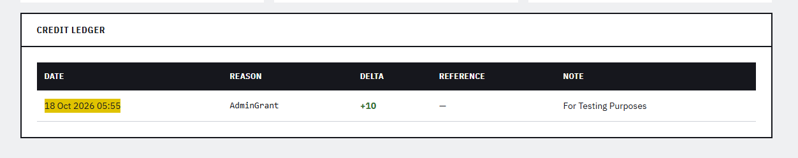

---

## Finding #2

- **Title / Summary**: Confusing Admin Exams UI/UX
- **Category**: [ ] CRASH (500) | [X] LOGIC / INVARIANT | [ ] DEAD-END | [X] UX / POLISH
- **Where & Who**:
  - URL: `http://localhost:5000/admin/exams`
  - Account: ADMIN
- **Steps to Reproduce**:
  1. Go to `http://localhost:5000/admin/exams`
- **Expected Behavior**: Categorized Exam Certificates, Categorized Purpose (Speaking, Writing...)
- **Actual Behavior**: A full list, which is very hard to navigate. And it's very badly categorized, and why would you list "audio" on a reading , general task!?
- **Ticket**: [#68](https://github.com/DemNgheTiengMua/toeic-practice-ui/issues/68)
- **Screenshots / Console Errors (F12)**:
  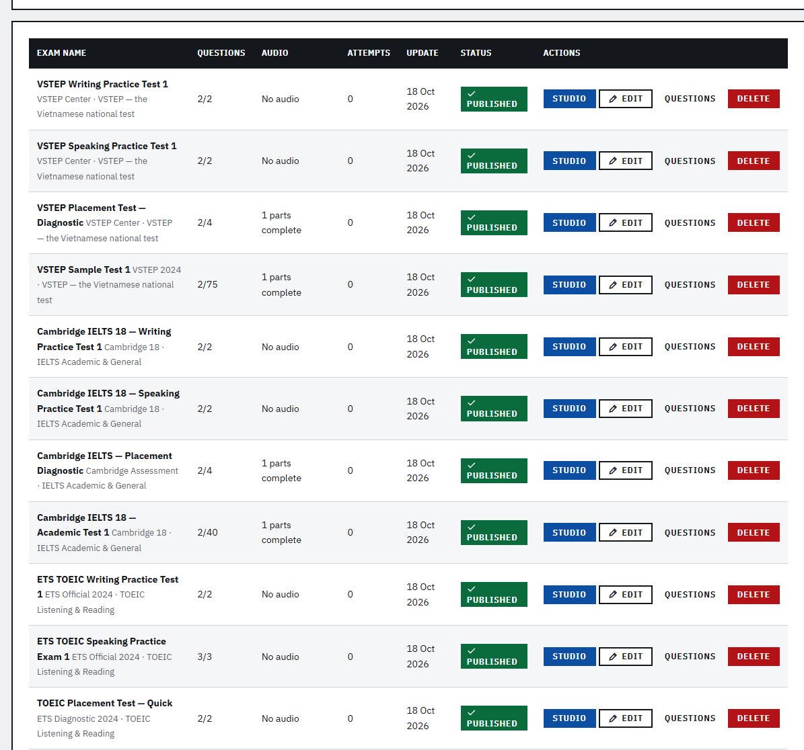

---

## Finding #3

- **Title / Summary**: Confusing Logic + CRASH
- **Category**: [X] CRASH (500) | [ ] LOGIC / INVARIANT | [X] DEAD-END | [ ] UX / POLISH
- **Where & Who**:
  - URL: `admin/exams/{id:int}/questions`
  - Account: ADMIN
- **Steps to Reproduce**:
  1.Go to `http://localhost:5000/admin/exams` 2. Click on any "QUESTION" button
- **Expected Behavior**: I don't even know, what's STUDIO do? And what this regular stuff do?
- **Actual Behavior**:An unhandled exception occurred while processing the request.
- **Ticket**: [#69](https://github.com/DemNgheTiengMua/toeic-practice-ui/issues/69)
- **Screenshots / Console Errors (F12)**:
  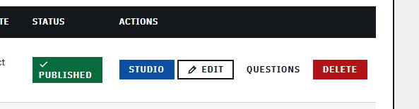
  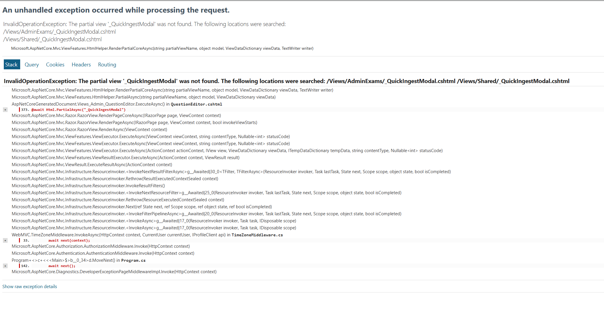

---

## Finding #4

- **Title / Summary**:Confusing Logic + CRASH #2
- **Category**: [X] CRASH (500) | [ ] LOGIC / INVARIANT | [X] DEAD-END | [ ] UX / POLISH
- **Where & Who**:
  - URL: `http://localhost:5000/admin/exams/{id:int}/edit?step=3`
  - Account: ADMIN
- **Steps to Reproduce**:
  1. Go to step 3 in edit
  2. Click "ENTER QUESTIONS" on any part
  3. Or click "OPEN QUESTION EDITOR"
- **Expected Behavior**: the same I don't even know, what's STUDIO do? And what this regular stuff do?
- **Actual Behavior**:An unhandled exception occurred while processing the request.
- **Ticket**: [#69](https://github.com/DemNgheTiengMua/toeic-practice-ui/issues/69)
- **Screenshots / Console Errors (F12)**:
  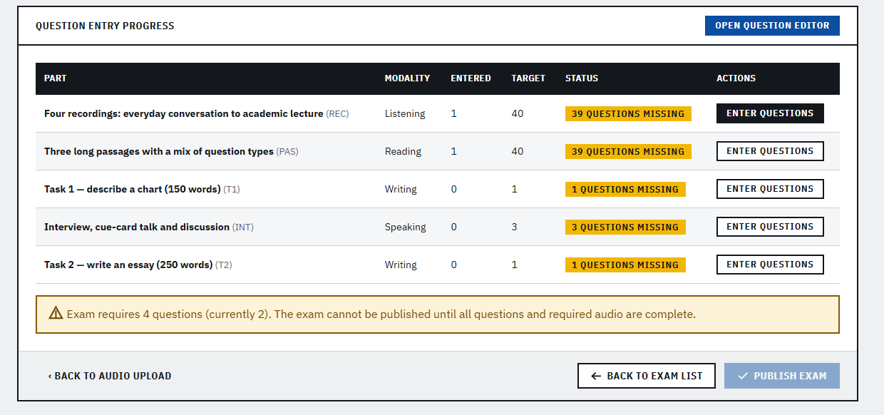
  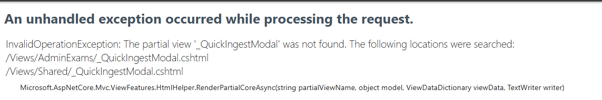

---

## Finding #5

- **Title / Summary**: Broken Lesson import UI/UX
- **Category**: [ ] CRASH (500) | [ ] LOGIC / INVARIANT | [ ] DEAD-END | [X] UX / POLISH
- **Where & Who**:
  - URL: `http://localhost:5000/admin/lessons`
  - Account: ADMIN
- **Steps to Reproduce**:
  1. Go to `http://localhost:5000/admin/lessons`
  2. Enjoy
- **Expected Behavior**: A good UI, import should be hidden behind a button, etc....
- **Actual Behavior**: A broken mess
- **Ticket**: [#70](https://github.com/DemNgheTiengMua/toeic-practice-ui/issues/70)
- **Screenshots / Console Errors (F12)**:
  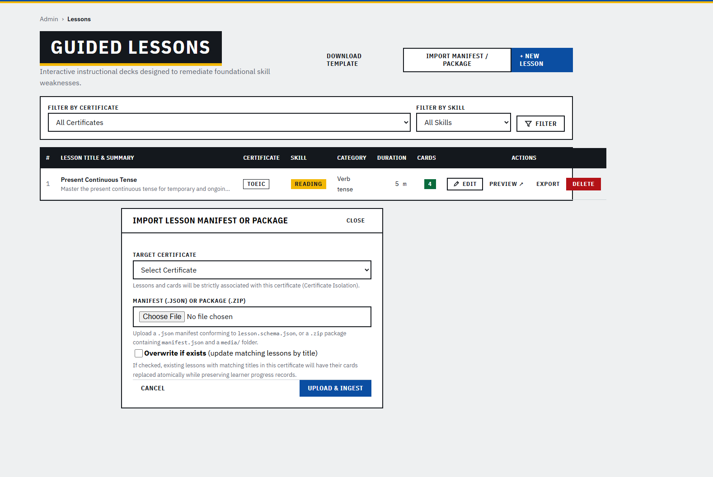

---

## Finding #6

- **Title / Summary**: Inconsistant Logic for bulk importing
- **Category**: [ ] CRASH (500) | [X] LOGIC / INVARIANT | [ ] DEAD-END | [X] UX / POLISH
- **Where & Who**:
  - URL: `http://localhost:5000/admin/imports`
  - Account: ADMIN
- **Steps to Reproduce**:
- **Expected Behavior**: Is is suppose to be the same thing with EXAMS `http://localhost:5000/admin/exams`? I should be a button or a wizard in there
- **Actual Behavior**: Seperate Part for some reason, also upload for what? It's just too confusing.
- **Ticket**: [#71](https://github.com/DemNgheTiengMua/toeic-practice-ui/issues/71)
- **Screenshots / Console Errors (F12)**:
  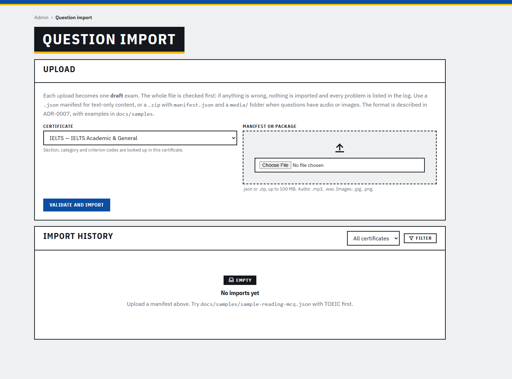

---

## Finding #7

- **Title / Summary**: UI Shifting, inconsistant
- **Category**: [ ] CRASH (500) | [ ] LOGIC / INVARIANT | [ ] DEAD-END | [X] UX / POLISH
- **Where & Who**:
  - URL: `http://localhost:5000/admin/users` & `http://localhost:5000/admin/orders`
  - Account: ADMIN
- **Steps to Reproduce**:
  1. Enter either these 2 links
- **Expected Behavior**: Normal admin ui like other screens
- **Actual Behavior**: Header changes and the sidebar is gone.
- **Ticket**: [#72](https://github.com/DemNgheTiengMua/toeic-practice-ui/issues/72)
- **Screenshots / Console Errors (F12)**:
  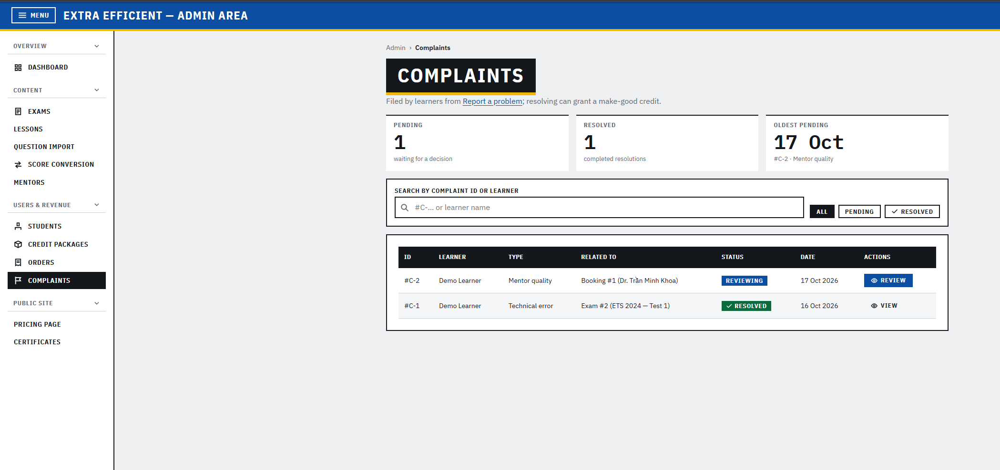
  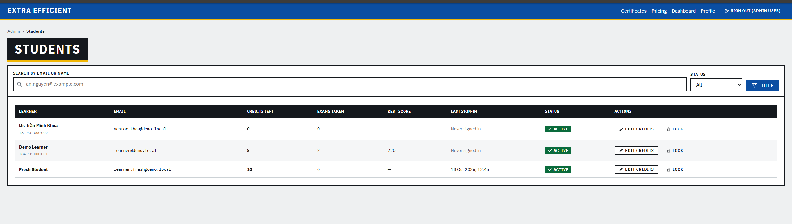
  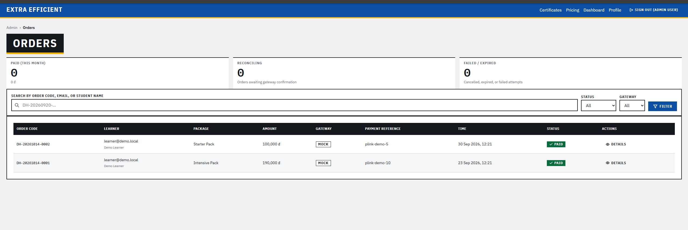

---

## Finding #8

- **Title / Summary**: Submit audio with Text??? AND MANUALLY ENTER SIZE? WHAT
- **Category**: [ ] CRASH (500) | [ ] LOGIC / INVARIANT | [ ] DEAD-END | [X] UX / POLISH
- **Where & Who**:
  - URL: `http://localhost:5000/admin/exams/1/edit?step=2`
  - Account: ADMIN
- **Steps to Reproduce**:
  1. Goto EDIT => Upload Listening Audio
  2. Click Replace File/ Path
  3. ENJOY
- **Expected Behavior**: Upload a file and that's it
- **Actual Behavior**: I have to enter path as text, manually enter duration and size, wtf
- **Ticket**: [#73](https://github.com/DemNgheTiengMua/toeic-practice-ui/issues/73)
- **Screenshots / Console Errors (F12)**:
  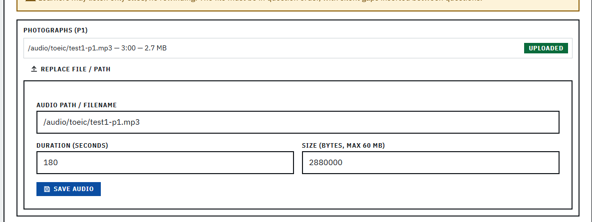

---
