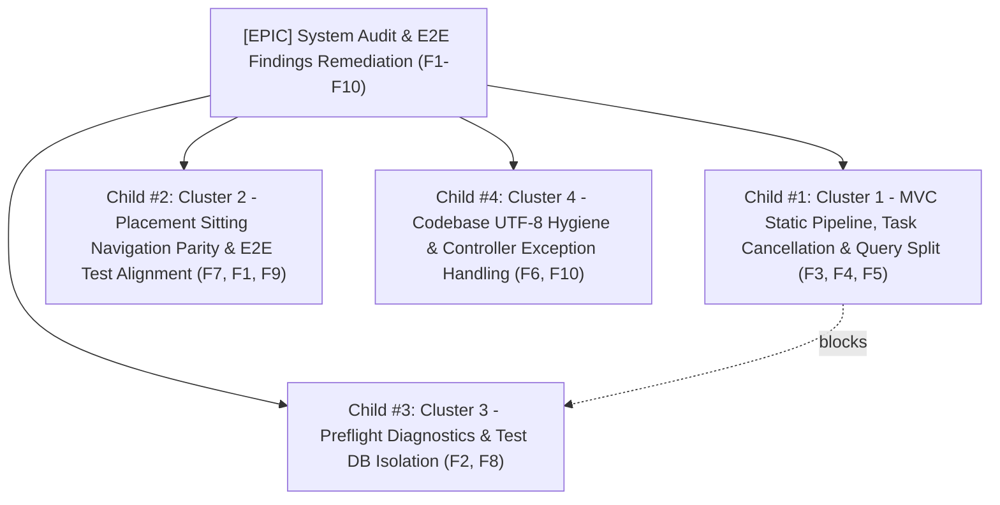

# Cross-Role Audit & E2E Findings Remediation Specification (F1–F10)

## 1. Overview & Background

During comprehensive system audit and automated E2E journey execution on branch `main` (commit `f029d82`), 10 concrete defects and architectural misalignments (F1–F10) were surfaced across the test harness, MVC pipeline, sitting mechanics, and API resilience.

This document serves as the master engineering specification to remediate these findings systematically. The work is structured into four cohesive, decoupled clusters designed for parallel or ordered execution by developers and autonomous agents:

- **Cluster 1**: MVC Static Pipeline Order, Task Cancellation Handling & Query Optimization (F3, F4, F5) — *Performance & Noise Remediation*
- **Cluster 2**: Sitting Navigation Lock Parity & E2E Test Alignment (F7, F1, F9) — *Security, Exam Integrity & Documentation*
- **Cluster 3**: Preflight Verification Diagnostics & Test Harness Isolation (F2, F8) — *Sitting Stability & Test Rigor*
- **Cluster 4**: Codebase Hygiene, Character Encoding & Exception Resilience (F6, F10) — *UX Polish & Reliability*

---

## 2. Invariants & Architecture Guardrails

All remediation work must strictly comply with the architectural rules established in `AGENTS.md` and repository ADRs:
1. **Database-First Schema Authority (`docs/adr/0001-database-first-ef-core.md`)**: No ad-hoc EF migrations. Database schema in `docs/database-schema.sql` remains single source of truth.
2. **MVC Proxies API (`docs/adr/0002-mvc-proxies-api-with-cookie-token.md`)**: MVC never bypasses WebAPI. JWT remains in HttpOnly cookie; browser scripts never touch bearer tokens directly.
3. **Sitting Navigation Security Invariant**: Server-side navigation locks (`AUDIO_DRIVEN` one-way forward navigation, `SYSTEM_PACED_AUTO` progression, unit/phase/group locks) enforced in `IAttemptEngine` and controller actions must **never** be weakened or bypassed.
4. **Clean Log Output**: `scripts/crawl-env.sh errors` must be free of false-positive `fail:` entries for client disconnects or aborted requests.
5. **No Visual Regressions**: Maintain the "Bảng hiệu phòng thi" design system (`DESIGN.md`): `border-radius: 0`, `box-shadow: none`, flat painted signboards, IBM Plex fonts.

---

## 3. Work Clusters & Detailed Technical Specifications

### Cluster 1: MVC Static Pipeline Order, Task Cancellation Handling & Query Optimization

#### Findings Addressed
- **F3** (`[PERF/NOISE]`): Static asset requests trigger authentication (`GET /api/auth/me`) and timezone middleware (`GET /api/profile`).
- **F4** (`[CRASH-NOISE]`): Browser aborts asset/page loads, causing unhandled `TaskCanceledException` / `OperationCanceledException` logged as `fail: JwtBearerHandler` and bubbling to HTTP 500.
- **F5** (`[PERF]`): Multiple collection `.Include()` queries in `AdminExamService.AuditExamPublishReadinessAsync` without `.AsSplitQuery()` triggering EF Core warning `[20504]` and Cartesian explosion.

#### Detailed Specification
1. **Pipeline Ordering in `src/WebMVC/Program.cs`**:
   - Move `app.MapStaticAssets()` above `app.UseAuthentication()` and `app.UseMiddleware<TimeZoneMiddleware>()`.
   - Ensure static assets (`/css/*`, `/js/*`, `/images/*`, `/audio/*`, fonts) are served immediately by the static asset endpoint without invoking cookie authentication principal validation or calling upstream WebAPI endpoints.
   - Result: Eradicates thousands of redundant HTTP calls to WebAPI per minute and resolves browser audio/asset cancellation cascading into the authentication subsystem.

2. **Client Abort & Cancellation Handling in WebAPI**:
   - In `src/WebAPI/Extensions/AuthenticationExtensions.cs`, wrap token validation session verification (`AuthService.CheckSessionAsync`) to catch `OperationCanceledException` when the HTTP request cancellation token is triggered by client disconnect. Do not log client disconnects as runtime failures.
   - In `src/WebAPI/Middleware/ExceptionHandlerMiddleware.cs` (or standard ASP.NET Core exception handlers), intercept `OperationCanceledException` and HTTP client disconnects (status code 499 / silent termination) rather than converting them into 500 Internal Server Error logs.
   - In `src/Services/Auth/AuthService.Sessions.cs:73`, ensure cancellation tokens passed to EF Core queries gracefully bubble or return without polluting error logs.

3. **Split Query for Exam Readiness Audit**:
   - In `src/Services/Admin/Exams/AdminExamService.Audit.cs:41-47`, append `.AsSplitQuery()` to the readiness check query loading `QuestionGroups`, `Questions`, and `Options`.
   - Scan `src/Services` for other multi-collection eager loads triggering EF Core warning `[20504]` and convert to split queries where Cartesian expansion risks query timeouts.

---

### Cluster 2: Sitting Navigation Lock Parity & E2E Test Alignment

#### Findings Addressed
- **F7** (`[LOGIC]`): Placement sitting room allows skipping server-side navigation locks via fragment navigation; `PlacementTakeViewModel` enables "Previous" button during audio-driven tests; `TakeFragment` redirects without `attemptId`.
- **F1** (`[LOGIC/TEST]`): E2E tests in `ExamAudioAndInstructionsTests.cs` fail because they assume candidates can navigate backwards in `AUDIO_DRIVEN` sections, which is now locked by server design (D3).
- **F9** (`[DOCS]`): `docs/MANUAL-TEST-FLOW.md` mentions obsolete `EX-XXXXXX` candidate codes and resume placards removed in D4.

#### Detailed Specification
1. **Placement Navigation Lock & URL Synchronization**:
   - In `src/WebMVC/wwwroot/js/placement/take.js`, refactor `navigate(targetQuestion)`:
     - Do not execute `window.history.pushState(null, '', \`?q=${targetQuestion}\`)` optimistically before the server responds.
     - Inspect the HTML fragment or response returned by the server: push or replace state with the **actual** question number confirmed by the server response header or response payload.
   - In `src/WebMVC/ViewModels/Placement/PlacementTakeViewModel.cs` (lines 20–23):
     - Align `CanGoPrevious` logic with `ExamTakeViewModel.cs`: if the exam section mode is `AUDIO_DRIVEN` or `SYSTEM_PACED_AUTO`, `CanGoPrevious` must evaluate to `false` regardless of `DisplayOrder > 1`.
   - In `src/WebMVC/Controllers/PlacementController.cs` (lines 125–128):
     - Fix `TakeFragment` action redirection: when redirecting to Preflight, pass both `id` (`placementId`) and `attemptId` (`new { id = placementId, attemptId }`), preventing 404 / redirect cascades to `/exams`.

2. **E2E Test Alignment with D3 Navigation Locks**:
   - In `tests/WebMVC.E2ETests/Journeys/ExamAudioAndInstructionsTests.cs`:
     - Update `Should_Not_Lock_Replay_When_Navigating_Away_From_Unplayed_Question` and `Should_Resume_From_Last_Timestamp_And_Prevent_Rewind_When_Returning_To_Partial_Audio`.
     - Align test assertions with D3 invariant: assert that attempting to jump backwards to an earlier question in `AUDIO_DRIVEN` mode is refused or redirected to the active question by the server.
     - Verify audio timestamp persistence and resume mechanics within the active question cluster or permitted forward navigation paths.

3. **Manual Test Documentation Synchronization**:
   - In `docs/MANUAL-TEST-FLOW.md`:
     - Update §4.2 steps 4 and 6, and §10 checklist to remove mentions of `EX-XXXXXX` exam codes and candidate code placards.
     - Document that exam resumption is triggered strictly via the "Tiếp tục" CTA on the exam card or sitting room URL.

---

### Cluster 3: Preflight Verification Diagnostics & Test Harness Isolation

#### Findings Addressed
- **F2** (`[CRASH?/FLOW]`): Preflight check timed out or silently looped on first run in `SittingAndPracticeQolTests.cs:274`.
- **F8** (`[TEST-INFRA]`): `PlaywrightTestBase.cs` hardcodes default connection string to `ExtraEfficiency` instead of respecting `ExtraEfficiencyCrawl` or `TEST_DB_CONNECTION`.

#### Detailed Specification
1. **E2E Test Database Isolation**:
   - In `tests/WebMVC.E2ETests/PlaywrightTestBase.cs` (lines 59–72):
     - Inspect environment variables `TEST_DB_CONNECTION` and `TEST_DB_NAME`.
     - Dynamically resolve the connection string to target `ExtraEfficiencyCrawl` when running in crawl environments or when `TEST_DB_NAME=ExtraEfficiencyCrawl` is set.
     - Prevent accidental mutations (such as test attempt cancellations, credit top-ups, or session resets) from contaminating the default `ExtraEfficiency` database.

2. **Preflight Verification Diagnostics & Resilient Error Surfacing**:
   - In `src/WebMVC/Controllers/ExamsController.cs` (lines 144–149) and `PlacementController.cs`:
     - When `VerifyPreflight` fails with `ApiException`, log the structured exception message and error payload at `LogLevel.Warning` rather than silently redirecting.
     - Ensure `TempData["ErrorMessage"]` is rendered prominently on `Views/Exams/Preflight.cshtml` using a standard design-system error placard.
   - Investigate why `SittingAndPracticeQolTests:274` timed out waiting for `/exams/take/3`: verify if equipment verification failed, or if an existing attempt state required explicit resume parameters.

---

### Cluster 4: Codebase Hygiene, Character Encoding & API Failure Resilience

#### Findings Addressed
- **F6** (`[UX-BROKEN]`): Non-UTF8 byte sequences in `placement/take.js` (byte `0x85`) and `_TakeNavigator.cshtml` (byte `0xB7`) corrupt UI text and aria labels.
- **F10** (`[CRASH]`): Unhandled API exceptions in `ProfileController.Index` and `AdminCertificatesController.Index` / `Wizard` causing HTTP 500 error pages.

#### Detailed Specification
1. **Source File UTF-8 Encoding Remediation**:
   - Re-encode `src/WebMVC/wwwroot/js/placement/take.js` to pure UTF-8 without BOM: replace byte `0x85` with standard ellipsis character `…` (`\u2026`).
   - Re-encode `src/WebMVC/Views/Placement/_TakeNavigator.cshtml` to pure UTF-8 without BOM: replace byte `0xB7` with standard middle dot `·` (`\u00b7`).
   - Verify that automated encoding scanning (`Get-Content` raw byte check) confirms 100% UTF-8 compliance across all `src/**/*.{cs,cshtml,js,css,json,sql}`.

2. **Defensive API Error Handling in Controllers**:
   - In `src/WebMVC/Controllers/ProfileController.cs` (`Index` action):
     - Wrap API client calls in `try ... catch (ApiException ex)`.
     - On API error, log the failure and return a degraded view or informative error alert instead of crashing with unhandled 500.
   - In `src/WebMVC/Controllers/AdminCertificatesController.cs` (`Index` and `Wizard` actions):
     - Wrap API client calls in `try ... catch (ApiException ex)`.
     - Surface clear administrative banner messages on connection drops or validation issues.

---

## 4. Verification & Testing Strategy

Each fix must adhere to the 4-step verification gate defined in `AGENTS.md` §7:
1. **Red First**: Write or update tests in `tests/Services.Tests` or `tests/WebMVC.Tests` / `tests/WebMVC.E2ETests` reproducing the reported issue. Confirm test fails before the fix.
2. **Green**: Apply implementation and verify that targeted tests and full `dotnet test` pass.
3. **Re-walk in Crawl Environment**: Run `scripts/crawl-env.sh fresh` and perform the user journey in the browser or via Playwright.
4. **Clean Error Logs**: Verify `scripts/crawl-env.sh errors` produces 0 new `fail:` log entries.

---

## 5. Issue Breakdown & Dependency Hierarchy

- **Child 1 (Cluster 1)** blocks **Child 3 (Cluster 3)**: Log noise and unhandled cancellation exceptions must be cleared to reliably inspect Preflight API failures and test traces.
- **Child 2 (Cluster 2)** and **Child 4 (Cluster 4)** are unblocked and can be executed immediately.
