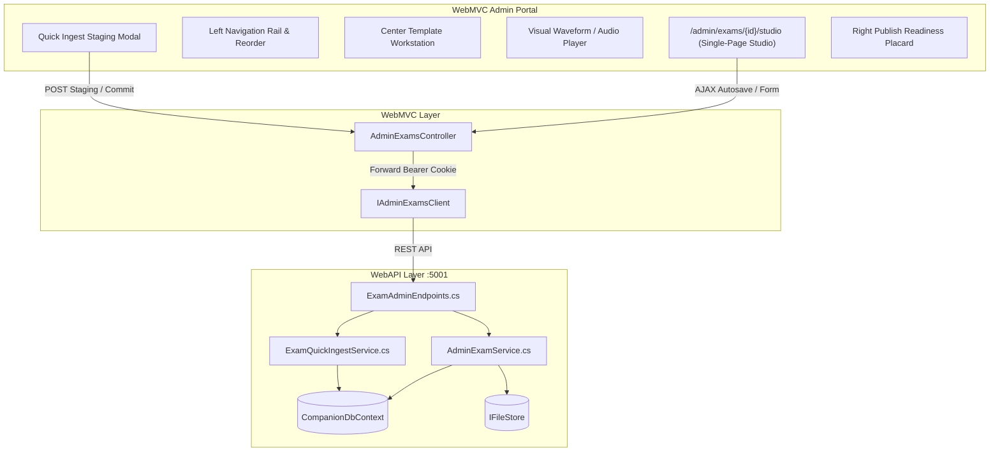

# Admin Exam Studio, Section Authoring Wizard & Quick Ingest Specification

## 1. Problem Statement

Creating and editing real-world certification exams (such as a 200-question TOEIC test or multi-part IELTS paper) currently suffers from two major friction points:
1. **Disjointed Multi-Page Admin Workflow**: Navigating between basic exam info (`/admin/exams/create`), audio uploads, and question editing (`/admin/exams/{id}/questions`) forces full page reloads, drops author context, and lacks a coherent overview of progress.
2. **Generic, One-Size-Fits-All Question Forms**: Distinct question formats (photo MCQs, spoken conversation clusters, reading passages with blanks, timed free responses) are forced into a generic form requiring manual millisecond audio slicing, manual file path typing, and raw entity management.
3. **No Interactive / Manual Ingest**: Admins copying questions from Word, PDF, or textbook drafts cannot paste text directly into the system with automatic parsing and visual error preview, forcing tedious manual input or offline JSON authoring.

This document specifies the end-to-end design and implementation of the **Admin Exam Studio, Section Authoring Wizard & Quick Ingest System** (ADR-0009).

---

## 2. User Stories

### Exam Studio Workspace
1. **As an admin**, I want a unified single-page workspace (`/admin/exams/{id}/studio`) containing a Left Navigation Rail, Center Workstation, and Right Readiness Placard, so that I can author an entire exam without leaving the page.
2. **As an admin**, I want the Left Rail to display all sections of the active certificate with question counts, completion badges, and drag-and-drop reordering, so that I can audit and organize exam structure at a glance.
3. **As an admin**, I want debounced background autosaving and an active "Saved at HH:mm" status indicator, so that my work is never lost to accidental browser closes or network drops.

### Section-Specific Authoring Wizard
4. **As an admin authoring TOEIC Part 1 (Photographs)**, I want a dedicated template with image drag-and-drop, required image alt text, audio file selector/slicer, and 4 option inputs with rationale fields.
5. **As an admin authoring TOEIC Part 2 (Question-Response)**, I want a simplified 3-option template (A, B, C) where stem text is optional (prompt audio only) and question groups are managed transparently.
6. **As an admin authoring TOEIC Part 3 & 4 (Conversations / Talks)**, I want to click "+ Add Cluster" to generate a group with an audio clip / transcript and 3 pre-provisioned MCQ question cards.
7. **As an admin authoring TOEIC Part 5 (Incomplete Sentences)**, I want a streamlined 4-option MCQ form with category selector (`QuestionCategories`) and explanation fields, with internal `QuestionGroups` completely abstracted away.
8. **As an admin authoring TOEIC Part 6 (Text Completion)**, I want to type `[1]`, `[2]`, `[3]`, `[4]` placeholders in the passage to automatically generate and synchronize 4 corresponding question cards with live inline dropdown previews.
9. **As an admin authoring TOEIC Part 7 (Reading Comprehension)**, I want multi-passage tabs (Single, Double, Triple passages) paired with a cluster of 2 to 5 MCQs.
10. **As an admin authoring Speaking & Writing (Free Response)**, I want inputs for preparation seconds, response seconds, minimum/maximum word counts, and an interactive checklist of rubric criteria (`GradingCriteria`) loaded from the certificate.

### Quick Ingest & Text Staging Box
11. **As an admin**, I want a "Quick Ingest" modal where I can paste raw exam text from Word/PDF, and have the system parse questions, options, answer keys (`*A.` or `ANSWER: A`), and explanations.
12. **As an admin**, I want a live pre-flight staging view showing parsed questions alongside validation errors (missing correct option, invalid format) before committing to the database.
13. **As an admin**, I want an "Append" vs "Replace Section" toggle on the Quick Ingest modal, so that I can either add questions to the end of a section or overwrite outdated questions cleanly.

### Media & Audio Slicing
14. **As an admin**, I want to drag-and-drop audio files directly into the Studio, with an integrated waveform/player that lets me set Start and End timestamps (`AudioStartMs`, `AudioEndMs`) by clicking "Mark Start" and "Mark End" during playback.
15. **As an admin**, I want to support both master section audio slicing and discrete question-group audio uploads.

### Publish Readiness Audit & Export
16. **As an admin**, I want a "Publish Readiness Audit" panel that validates the exam against all certificate constraints (question counts, MCQ correct option keys, audio presence, rubric criteria) and provides jump-links to invalid questions.
17. **As an admin**, I want a "Publish" button that is blocked until all audit checks pass ("Block Before Publish").
18. **As an admin**, I want an "Export JSON / ZIP" button to download the entire exam package conforming to ADR-0007 at any time.

---

## 3. Domain Invariants & Rules

1. **Certificate Isolation**: All sections, categories, and rubric criteria are strictly partitioned by `CertId`. No cross-certificate references are permitted.
2. **Option Invariance (`UX_Options_OneCorrect`)**: Every MCQ question must have at least 2 options and **exactly one** option marked `IsCorrect = 1`.
3. **Image Alt Text (`CK_QGroups_ImageAlt`)**: Any question group with an `ImagePath` must include a non-empty `ImageAlt`.
4. **Audio Slicing Integrity (`CK_QGroups_AudioSlice`)**: If audio slicing is used, `AudioEndMs > AudioStartMs >= 0`. Both must be provided together.
5. **Modality Integrity (`trg_QGroups_SkillPracticeOneModality`)**: Speaking/writing practice exams cannot contain MCQ or listening questions.
6. **Block Before Publish**: An exam cannot transition from `draft` to `published` status if any section is missing required question counts, any MCQ lacks a correct answer, or any listening section lacks audio.
7. **Contiguous Display Orders**: Questions and groups within a section must maintain zero-indexed contiguous `DisplayOrder` values.
8. **UI Design System ("Bảng hiệu phòng thi")**: All views must use 2px ink keylines (`#14181d`), 1px soft rules (`#ccd2d6`), 0px border-radius, no box shadows, IBM Plex Mono for numbers/timers/counts, IBM Plex Sans Condensed for placards, and signage state colors (Blue `#0b4ea2`, Green `#0a6b3c`, Red `#b31217`, Gold `#f2b705`).

---

## 4. Quick Ingest Text Grammar

The Quick Ingest parser accepts human-readable raw text using the following flexible rules:

```text
[Question Number]. [Stem Text]
(Optional Category/Hint: [Category Code] or Hint: [Hint Text])
[Option Label] [Option Text]
[Option Label] [Option Text]
...
ANSWER: [Correct Label]  (OR * before correct option label, e.g. *A. text)
EXPLANATION: [Explanation Text]
```

### Supported Variations
- Option prefixes: `A.`, `A)`, `(A)`, `[A]`, `a.`
- Inline correct answer: `*A. Correct answer text` or `A. Correct answer text *`
- Trailing answer key: `ANSWER: A`, `Answer: A`, `KEY: A`, `Key: A`, `ĐÁP ÁN: A`, `Đáp án: A`
- Explanation line: `EXPLANATION: ...`, `Explanation: ...`, `GIẢI THÍCH: ...`, `Giải thích: ...`
- Cluster separator: `---` or `===` or `PASSAGE:` tag for reading/listening clusters.

---

## 5. System Architecture & Endpoints



### Key API Endpoints
- `GET /api/admin/exams/{id}/studio`: Load complete exam hierarchy with section targets, groups, questions, and audio tracks.
- `POST /api/admin/exams/{id}/quick-ingest/parse`: Dry-run parse of text or JSON; returns structured preview with line-level validation errors.
- `POST /api/admin/exams/{id}/quick-ingest/commit`: Commits staged questions to a target section (supports `mode=append` or `mode=replace`).
- `PUT /api/admin/exams/{id}/reorder`: Bulk updates `DisplayOrder` for questions and groups within a section.
- `GET /api/admin/exams/{id}/audit`: Runs the publish readiness inspection rules and returns blocking errors and warnings.
- `POST /api/admin/exams/{id}/media`: Direct upload of image/audio asset returning permanent stored URL.
- `GET /api/admin/exams/{id}/export`: Exports the exam package in ADR-0007 format.

---

## 6. Implementation Breakdown & Phased Tickets

### Phase 1: Contracts, Quick Ingest Parser & Backend APIs
- DTOs in `Contracts`: `ExamStudioDto`, `QuickIngestParseRequest`, `QuickIngestParseResultDto`, `QuickIngestCommitRequest`, `ExamAuditResultDto`, `ReorderSectionItemsRequest`.
- Client methods in `IAdminExamsClient` and `CompanionApiClient`.
- Implement `IExamQuickIngestService` and `ExamQuickIngestService` with regex-based resilient text parsing, JSON fallback, and schema validation.
- Endpoints in `WebAPI/Endpoints/ExamEndpoints.cs`: studio load, quick-ingest parse/commit, reorder, audit check, export.
- Unit and integration tests in `Services.Tests` and `WebAPI.Tests`.

### Phase 2: WebMVC Single-Page Exam Studio & Section Templates
- Controller endpoints in `AdminExamsController` (`/admin/exams/{id}/studio`).
- ViewModels in `AdminExamViewModels.cs`.
- Create `Views/Admin/ExamStudio.cshtml` with:
  - Three-column layout adhering to "Bảng hiệu phòng thi".
  - Left Rail navigator with section accordions, question counters, and drag-and-drop / up-down ordering.
  - Section-Specific Workstation templates:
    - P1: Image upload + alt text + audio + 4 options.
    - P2: Prompt audio + 3 options.
    - P3/P4: Dialogue audio + transcript + 3 MCQ cluster.
    - P5: Sentence completion MCQ + Category dropdown + Explanation.
    - P6: Passage editor with `[1]`-`[4]` blank tokens + live preview.
    - P7: Multi-passage tabs + MCQ cluster.
    - Speaking / Writing: Timers, word limits, Rubric criteria checklist.
  - Visual Audio Player component with Mark In / Mark Out timestamp setting.

### Phase 3: Quick Ingest Modal, Autosave & Publish Readiness Audit
- Interactive Quick Ingest modal with text scratchpad, syntax guide, and live validation staging table.
- Client-side autosave engine with debounced AJAX calls, saving indicator, and `beforeunload` protection.
- Publish Readiness Audit panel with interactive checklist and jump-to-error links.
- Export manifest download action.
- Playwright E2E journey tests in `WebMVC.E2ETests`.
- Knowledge graph update via `graphify update .`.

---

## 7. Comprehensive Testing Strategy

To guarantee that the authoring wizard and ingest engine are airtight, testing will span 4 rigorous levels:

### 1. Parser & Validation Unit Tests (`Services.Tests/ExamQuickIngestServiceTests.cs`)
- **Format Variations**: Validates correct parsing of stems with inline asterisks (`*A. option`), separate answer keys (`ANSWER: A`, `KEY: B`, `ĐÁP ÁN: C`), and parenthesized options (`(A)`, `[B]`, `C)`).
- **Explanation & Category Extraction**: Ensures `EXPLANATION:` blocks are assigned to `Questions.Explanation` and category codes map to `QuestionCategories`.
- **Syntax Error Handling**: Asserts that malformed blocks (e.g., questions with fewer than 2 options, missing answer keys, multiple marked correct options) produce structured line-by-line error messages with exact line numbers.
- **Append vs Replace Integrity**: Asserts that Append retains existing questions and increments `DisplayOrder`, while Replace atomically prunes previous section items without corrupting foreign keys.

### 2. Service & Database Integration Tests (`Services.Tests/AdminExamServiceTests.cs`)
- **Reordering Integrity**: Asserts that `ReorderSectionItemsAsync` updates `DisplayOrder` contiguously (0, 1, 2...) for both questions and question groups.
- **Publish Readiness Rule Validation**:
  - Rejects publishing an exam whose question count does not match the certificate's expected count.
  - Rejects publishing if an MCQ lacks an `IsCorrect = 1` option (`UX_Options_OneCorrect`).
  - Rejects publishing if a listening section lacks an uploaded audio file or slice.
  - Rejects publishing if an image lacks alt text (`CK_QGroups_ImageAlt`).
- **Autosave Idempotency**: Tests that continuous background autosave requests do not create duplicate rows or produce race conditions.

### 3. Controller & Proxy Tests (`WebMVC.Tests/AdminExamsControllerTests.cs`)
- **Forwarding Integrity**: Verifies that Studio AJAX endpoints correctly forward anti-forgery tokens and propagate HttpOnly bearer cookies to WebAPI.
- **ViewModel Mapping**: Ensures section-specific metadata, audio paths, and audit results are accurately shaped for Razor rendering.

### 4. End-to-End Playwright Journey Tests (`WebMVC.E2ETests/Journeys/AdminExamStudioTests.cs`)
- **Admin Authoring Journey**:
  1. Sign in as Admin (`admin@extraefficiency.local`).
  2. Create a new draft exam and enter `/admin/exams/{id}/studio`.
  3. Use Quick Ingest to paste a 10-question reading drill; inspect the live staging table; click Commit.
  4. Author a Part 1 photo question using the dedicated template: drag-and-drop an image, enter alt text, set 4 options with rationales.
  5. Scribe a Part 6 text completion with `[1]`-`[4]` placeholders; verify child questions auto-generate.
  6. Attempt to publish prematurely -> verify the Readiness Audit panel blocks submission and highlights missing items.
  7. Fulfill remaining requirements -> verify exam successfully transitions to `published`.
- **Learner Verification Journey**:
  1. Sign in as a learner (`learner@extraefficiency.local`).
  2. Navigate to `/exams` and select the newly published exam.
  3. Sit for the exam in `AttemptEngine` (`/exams/{id}/take`):
     - Part 1 displays the uploaded image with alt text and plays the audio snippet.
     - Part 6 displays the passage with inline blanks and matching question options.
  4. Submit attempt -> verify score is calculated correctly and review screen displays the author's explanations and per-option rationales.

---

## 8. Confirmed Admin Operational Workflow

```
[Admin Exams List]
       │
       ▼ Click "Create Exam" or "Open Studio"
[Exam Studio Workspace (/admin/exams/{id}/studio)]
       │
       ├─► [Left Rail Navigator]
       │     └─ Click Section (e.g. "Part 3: Conversations")
       │     └─ Reorder Questions (Drag & Drop / Move Up-Down)
       │
       ├─► [Center Workstation (Template Adapts)]
       │     ├─ Direct Authoring Mode:
       │     │    ├─ Audio/Image Dropzone & Waveform Slicer (Mark In/Out)
       │     │    ├─ Section-Specific Cards (P1-P7, Speaking, Writing)
       │     │    └─ Debounced Background Autosave ("Saved at 16:45:00")
       │     │
       │     └─ Quick Ingest Mode:
       │          ├─ Click "Quick Ingest"
       │          ├─ Paste raw Word/PDF text or JSON
       │          ├─ Live Staging Preview (Line-by-line syntax & rule checks)
       │          └─ Select "Append" or "Replace Section" -> Commit
       │
       └─► [Right Readiness Placard]
             ├─ Target vs Actual Question Count Trackers
             ├─ Automated Compliance Checklist (Missing audio, answer keys, alts)
             ├─ Click Error -> Focuses faulty question card in Center Workstation
             └─ "Publish Exam" Button: Unlocked ONLY when checklist is 100% clean
```

---

## 9. End-User (Learner) Experience & Impact

The rigorous standards enforced by the Exam Studio directly transform what the student experiences during diagnostic testing and exam simulation:

| Exam Phase | Before (Seed-Only / Generic Admin) | With Exam Studio & Section Wizard |
| :--- | :--- | :--- |
| **Exam Catalog** | Only demo tests seeded via SQL available. | Rich, constantly updated catalog of real-world mock exams and topical drills. |
| **Taking Part 1 (Photos)** | Risk of missing image descriptions or broken media links. | Polished display: High-res image with screen-reader alt text, synchronized audio playback, 4 clean A-D option buttons. |
| **Taking Part 3/4 (Conversations)** | Questions sometimes disconnected from conversation scripts. | Clear question clusters: 1 shared audio player header anchoring exactly 3 dependent MCQs. |
| **Taking Part 6 (Text Completion)** | Questions shown as isolated questions without inline context. | Seamless passage reader: Text with embedded numbered blanks `[1]`, `[2]` highlighting corresponding question inputs. |
| **Taking Speaking / Writing** | Generic text box without timing or word bounds. | Exam-grade environment: Visual prep/speak countdown timer, live word counter ("142 / 150-300 words"), and grading criteria notice. |
| **Exam Review & Remediation** | Sparse answer keys often lacking explanations. | Rich feedback: Detailed per-question explanations, per-option distractor rationales ("Why option B was wrong"), full listening transcripts, and AI rubric breakdown. |
| **Reliability Invariant** | Potential for malformed exams with 0 or multiple correct answers. | **100% Guaranteed Reliability**: Every published exam is mathematically verified by the Publish Audit engine before reaching the learner. |
