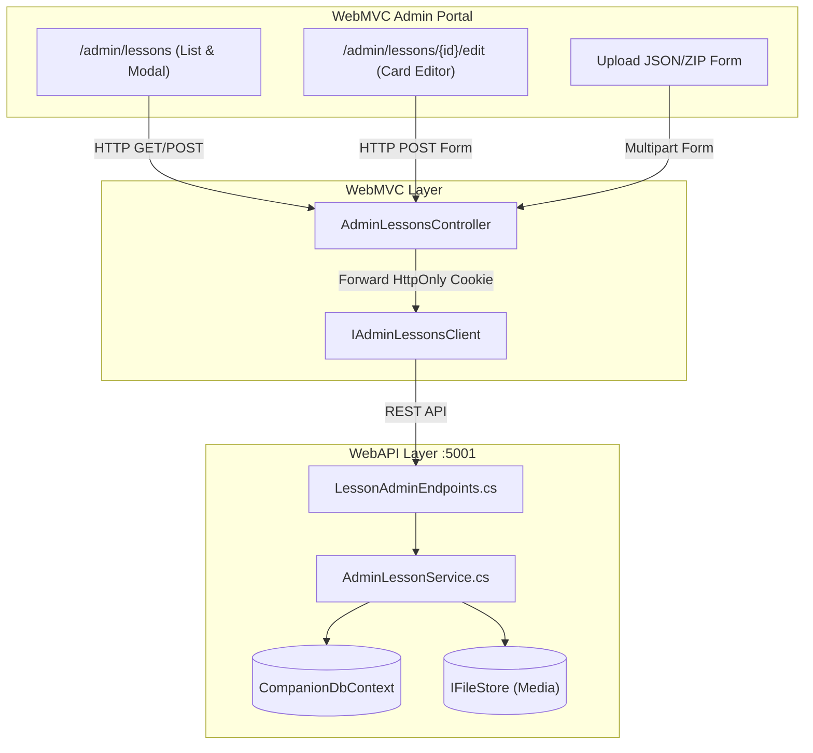

# Admin Lesson Authoring & Import System Specification

## 1. Problem Statement
The Guided Learning System introduced interactive walkthrough decks (`Lessons` and `LessonCards`) to remediate foundational weaknesses for learners. However, content creation currently relies solely on database seed scripts (`docs/seed-demo.sql`). 

Administrators and pedagogical authors have no user interface to:
1. Browse, search, and manage existing lessons across certificates.
2. Manually author and edit lessons and their cards via a rich visual editor with Markdown formatting and MCQ configuration.
3. Bulk-import lessons from structured `.json` manifests or `.zip` packages (with attached diagrams and images).
4. Export existing lessons to JSON for offline authoring, version control, and transfer between environments.
5. Download standardized sample templates to ensure valid schema compliance.

This document specifies the end-to-end design and implementation of the **Admin Lesson Authoring & Import System**.

---

## 2. User Stories

### Browsing & Management
1. **As an admin**, I want to view a list of all lessons filtered by active certificate and skill, so that I can see the curriculum coverage at a glance.
2. **As an admin**, I want to see key metadata for each lesson (Title, Skill, Category, Estimated Minutes, Card Count, Display Order) in a tabular placard, so that I can audit content completeness.
3. **As an admin**, I want to delete a lesson with confirmation, so that outdated or erroneous curriculum can be pruned cleanly.
4. **As an admin**, I want a direct link from each lesson row to preview how the learner experiences it, so that I can verify pedagogical quality.

### Manual Authoring & Editing
5. **As an admin**, I want a single-page consolidated editor (`/admin/lessons/create` and `/admin/lessons/{id}/edit`), so that I can manage the lesson metadata and all its cards without multiple page roundtrips.
6. **As an admin**, I want to configure lesson metadata: Certificate, Skill, Category, Title, Summary, Estimated Minutes, and Display Order.
7. **As an admin**, I want to dynamically add, delete, and reorder cards within a lesson.
8. **As an admin**, I want to set the `CardType` for each card (`rule`, `pitfall`, `example`, `micro_check`), with the interface adapting fields accordingly.
9. **As an admin**, I want to write card content in GitHub-flavored Markdown for Rule, Pitfall, and Example cards, so that formatting (formulas, bold terms, code blocks) is rendered accurately.
10. **As an admin editing a Micro-Check card**, I want dedicated input fields for Question Prompt, 4 options (A, B, C, D), correct option radio, Explanation, and distractor Rationale.

### Bulk Import & Package Upload
11. **As an admin**, I want to upload a `.json` manifest (containing one or multiple lessons), so that I can import lessons authored in external editors.
12. **As an admin**, I want to upload a `.zip` package containing a `manifest.json` and a media folder of images, so that diagrams and charts embedded in lesson cards are ingested automatically (ADR-0007 alignment).
13. **As an admin**, I want an "Overwrite if exists" toggle on the import modal, so that matching `(CertId, Title)` records are updated in place rather than rejected.
14. **As an admin**, I want strict validation before saving, so that malformed manifests, missing correct options, or invalid categories are caught with actionable line-by-line error messages.
15. **As an admin**, I want an import summary report detailing how many lessons and cards were created or updated.

### Template & Export
16. **As an admin**, I want to click "Download Sample Template" to obtain a validated `lesson-template.json`, so that I have an exact reference for authoring files.
17. **As an admin**, I want to click "Export JSON" on any existing lesson, so that I can inspect its complete serialized representation or back it up.

---

## 3. Domain Invariants & Rules

1. **Certificate Isolation**: All lessons and cards are bound to a specific `CertId`. An import or manual creation under `TOEIC` can never reference skills, categories, or path steps belonging to `IELTS`.
2. **Card Type Constraints**: `CardType` must strictly be one of `'rule'`, `'pitfall'`, `'example'`, `'micro_check'`.
3. **Micro-Check Completeness**:
   - For `micro_check`, `QuestionPrompt`, `OptionA`, `OptionB`, `OptionC`, `OptionD`, `CorrectOption`, and `Explanation` are mandatory.
   - `CorrectOption` must be one of `'A'`, `'B'`, `'C'`, `'D'`.
4. **Display Order Integrity**: Cards within a lesson must have contiguous `DisplayOrder` starting at 0.
5. **Path Step Referential Integrity**: If a lesson is deleted, foreign key checks must ensure it is not referenced by active `PathModuleItems` (`RefLessonId`). If referenced, deletion must be blocked with an informative error prompting removal from path templates first.
6. **Overwrite Invariance**: When "Overwrite" is enabled, existing cards for that lesson are replaced atomically in a database transaction, while preserving `LessonId` and active learner progress records where possible.
7. **Design System "Bảng hiệu phòng thi"**: All admin UI views must follow flat keylines (2px ink `#14181d`, 1px soft `#ccd2d6`), no border radius, no box shadows, uppercase headers in IBM Plex Sans Condensed, and mono numerals in IBM Plex Mono.

---

## 4. Lesson Manifest JSON Schema (`lesson.schema.json`)

```json
{
  "$schema": "https://json-schema.org/draft/2020-12/schema",
  "title": "LessonImportManifest",
  "type": "object",
  "required": ["lessons"],
  "properties": {
    "lessons": {
      "type": "array",
      "items": {
        "type": "object",
        "required": ["title", "skill", "cards"],
        "properties": {
          "title": { "type": "string", "maxLength": 160 },
          "skill": { "type": "string", "description": "Skill code (e.g. 'reading', 'listening')" },
          "categoryCode": { "type": "string", "description": "Optional category code matching QuestionCategories" },
          "summary": { "type": "string", "maxLength": 500 },
          "estimatedMinutes": { "type": "integer", "minimum": 1, "default": 5 },
          "displayOrder": { "type": "integer", "default": 0 },
          "cards": {
            "type": "array",
            "items": {
              "type": "object",
              "required": ["type", "title", "contentMarkdown"],
              "properties": {
                "type": { "type": "string", "enum": ["rule", "pitfall", "example", "micro_check"] },
                "title": { "type": "string", "maxLength": 160 },
                "contentMarkdown": { "type": "string" },
                "questionPrompt": { "type": "string" },
                "optionA": { "type": "string", "maxLength": 250 },
                "optionB": { "type": "string", "maxLength": 250 },
                "optionC": { "type": "string", "maxLength": 250 },
                "optionD": { "type": "string", "maxLength": 250 },
                "correctOption": { "type": "string", "enum": ["A", "B", "C", "D"] },
                "explanation": { "type": "string" },
                "rationale": { "type": "string" }
              }
            }
          }
        }
      }
    }
  }
}
```

---

## 5. System Architecture & Endpoints



### WebAPI Endpoints
- `GET /api/admin/lessons?certId={certId}&skillId={skillId}`: List lessons with summaries.
- `GET /api/admin/lessons/{id}`: Detailed lesson with all cards for editing.
- `POST /api/admin/lessons`: Create a new lesson and cards.
- `PUT /api/admin/lessons/{id}`: Update existing lesson metadata and cards.
- `DELETE /api/admin/lessons/{id}`: Delete lesson (checks FK references).
- `POST /api/admin/lessons/import?certId={certId}&overwrite={bool}`: Multipart upload (.json or .zip package).
- `GET /api/admin/lessons/{id}/export`: Export single lesson as JSON manifest.
- `GET /api/admin/lessons/template`: Return standard sample JSON template.

---

## 6. Implementation Breakdown & Tickets

To ensure systematic and verified execution, this feature will be partitioned into 3 sequential issues:

1. **Issue 1: Contracts, Admin Lesson Service & WebAPI Endpoints**
   - Wire DTOs in `Contracts`: `AdminLessonSummaryDto`, `AdminLessonDetailDto`, `AdminLessonUpsertDto`, `AdminLessonCardUpsertDto`, `AdminLessonImportResultDto`.
   - `IAdminLessonsClient` and methods in `CompanionApiClient`.
   - `IAdminLessonService` & `AdminLessonService` in `Services`: JSON/ZIP parsing, card validation, overwrite handling, and export generation.
   - Minimal API endpoints in `WebAPI/Endpoints/AdminLessonEndpoints.cs`.
   - Unit tests covering service validation and API mappings.

2. **Issue 2: WebMVC Controller, Admin Views & Single-Page Card Editor**
   - `AdminLessonsController` inheriting `AdminControllerBase`.
   - ViewModels in `WebMVC/Models/AdminLessonViewModels.cs`.
   - `Views/Admin/Lessons/Index.cshtml`: Placard table, certificate/skill filters, import modal with file drop & overwrite checkbox, export buttons.
   - `Views/Admin/Lessons/Edit.cshtml`: Single-page editor with dynamic card addition, card type switching, and live markdown preview.
   - Update Admin navigation menu to include "Lessons".
   - Controller unit tests in `WebMVC.Tests`.

3. **Issue 3: Sample Package, E2E Browser Verification & Documentation**
   - Create downloadable `lesson-template.json` in `src/WebAPI/wwwroot/templates/` or embedded resource.
   - Add sample TOEIC lesson import fixture for testing.
   - Add Playwright E2E journey test in `WebMVC.E2ETests/Journeys/AdminLessonsTests.cs` (Testing manual creation, editing cards, and importing JSON).
   - Update knowledge graph with `graphify update .`.
